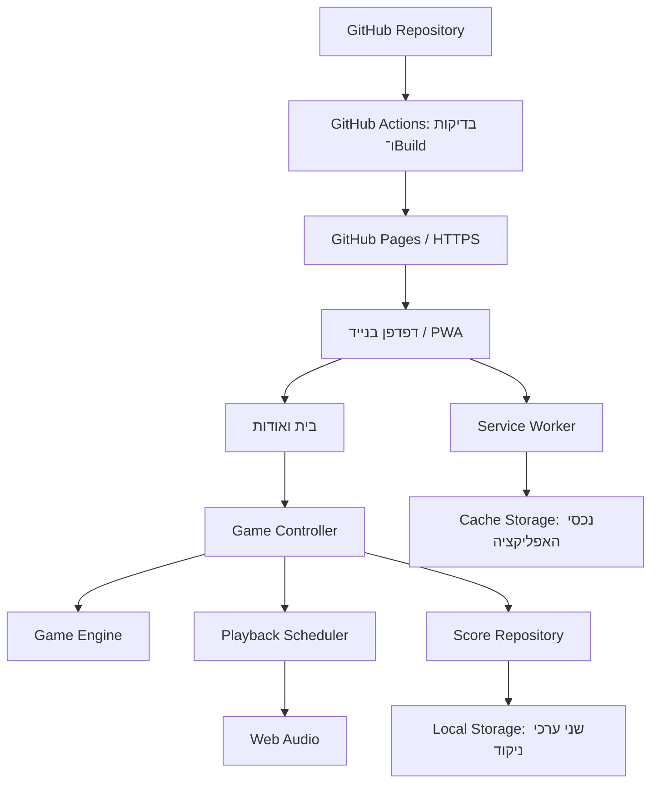

# ARCHITECTURE — סיימון

תאריך מחקר: 18 באוקטובר 2026. מבוסס על `PRD.md` ועל המקורות הרשמיים המקושרים במסמך. זהו תכנון למימוש; לא בוצעו במסגרתו פיתוח אפליקציה, פתיחת Repository או Deployment בפועל.

## 1. Technology Stack שנבחר

| רכיב | בחירה | אחריות |
|---|---|---|
| Frontend | TypeScript במצב `strict`, עם HTML ו־DOM APIs | שני המסכים, לוגיקת המשחק והטיפוסים |
| עיצוב | CSS רגיל, CSS Grid ו־CSS Custom Properties | Mobile-First, לוח 2×2, RTL והדגשת צבעים |
| Development ו־Build | Vite, בתצורת `vanilla-ts` | שרת פיתוח ויצירת אתר סטטי ל־Production |
| סביבת כלים | Node.js 24 LTS ו־npm | הרצת כלי הפיתוח ו־CI בלבד |
| שמע | Web Audio API | יצירת ארבעה צלילים מקומיים, ללא קובצי שמע חיצוניים |
| מצב משחק | State Machine מקומית ב־TypeScript | שליטה בשלבים, קלט, השהיה וסיום |
| ניווט | Hash Navigation מקומית | `#/` לבית ו־`#/about` לאודות, ללא Router חיצוני |
| הישגים | Local Storage | שמירת שיא ותוצאת משחק אחרון |
| PWA ו־Offline | `vite-plugin-pwa` עם Workbox במצב `generateSW` | Manifest, יצירת Service Worker ו־Precache |
| נכסים | SVG מקומי ללוגו ו־PNG מקומי לאייקונים | מיתוג, אייקונים והתקנה |
| Unit Tests | Vitest | חוקי המשחק, הניקוד וקריאת הנתונים השמורים |
| בדיקות דפדפן | בדיקה ידנית | בדיקת הזרימות בדפדפן בגודל מובייל ובטלפון של המשתמש, ללא כלי אוטומציה |
| קוד ופרסום | GitHub ו־GitHub Actions | ניהול גרסאות; Workflow פרסום שמריץ Type Checking, ‏Unit Tests ו־Build לפני כל פרסום |
| Hosting | GitHub Pages ב־HTTPS | הגשת תוצר ה־Build הסטטי |

אין Backend, Database, Authentication, אחסון קבצים בענן, APIs עסקיים, שירותי AI או אינטגרציות חיצוניות. Node.js אינו שרת של המוצר, ו־Cache Storage משמש לנכסי האפליקציה בלבד.

### נימוקי הבחירה

**Frontend:** נבחנו TypeScript עם DOM, React ו־Vue. לשני מסכים, ארבעה כפתורים ומצב משחק קטן, הבחירה ב־DOM ישיר חוסכת Runtime של UI Framework ותלות במנגנון Rendering נוסף. TypeScript מספק טיפוסים לצבעים, לאירועים ולמצבים; מודולים קטנים וגבולות ברורים מאפשרים תחזוקה ופיתוח באמצעות AI. React ו־Vue מספקים מודלי Components מתועדים, אך היקף המוצר אינו מצדיק את התוספת. זו מסקנת התאמה למוצר, ולא טענה שהם אינם מתאימים למשחקים. מקורות: [TypeScript](https://www.typescriptlang.org/docs/handbook/typescript-in-5-minutes.html), [React](https://react.dev/learn), [Vue](https://vuejs.org/guide/introduction.html).

**Build:** נבחנו Vite, webpack ו־Parcel. Vite נבחר בשל תבנית `vanilla-ts`, תצורה מצומצמת, שילוב עם Vitest ו־PWA ותיעוד פריסה ישיר ל־GitHub Pages. CSS רגיל מספיק ללוח קטן; אין צורך ב־CSS Framework או ספריית Components. מקורות: [Vite](https://vite.dev/guide/), [webpack](https://webpack.js.org/concepts/), [Parcel](https://parceljs.org/).

**PWA:** נבחנו Workbox באמצעות `generateSW`, ‏`injectManifest` ו־Service Worker ידני. כל הנכסים סטטיים ואין API או לוגיקת רקע מיוחדת, ולכן יצירה אוטומטית של Precache מצמצמת קוד תחזוקה ושגיאות Cache. אין הצדקה ל־Service Worker מותאם אישית. מקורות: [דרכי השימוש ב־Workbox](https://developer.chrome.com/docs/workbox/the-ways-of-workbox), [Precache ב־Vite PWA](https://vite-pwa-org.netlify.app/guide/service-worker-precache).

**שמע ושמירה:** נבחנו Web Audio מול HTML Audio עם קבצים, ו־Local Storage מול IndexedDB. יצירת ארבעה טונים ב־Web Audio חוסכת הורדות ותומכת בתזמון ובעצירה; HTML Audio מתאים יותר להשמעת הקלטות מוכנות. שני מספרים אינם מצדיקים IndexedDB, ו־Local Storage נדרש במפורש ב־PRD. מקורות: [Web Audio](https://developer.mozilla.org/en-US/docs/Web/API/Web_Audio_API), [HTML Audio](https://developer.mozilla.org/en-US/docs/Web/HTML/Reference/Elements/audio), [Local Storage](https://developer.mozilla.org/en-US/docs/Web/API/Window/localStorage), [IndexedDB](https://developer.mozilla.org/en-US/docs/Web/API/IndexedDB_API).

**בדיקות:** נבחנו Vitest מול Jest. Vitest מתאים לתצורת Vite ול־TypeScript ומשמש רק לחוקי המשחק, שבהם הטעויות קשות לזיהוי בעין. זרימות המסכים, השמע, ה־Offline וההתקנה נבדקים ידנית: בדפדפן בגודל מובייל ובטלפון אמיתי, שהוא ממילא הדרך היחידה לבדוק שמע והתקנה בפועל. בדיקות דפדפן אוטומטיות (Playwright או Cypress) אינן מוצדקות להיקף של שני מסכים, וראו ADR-1. מקורות: [Vitest](https://vitest.dev/guide/), [Jest](https://jestjs.io/docs/getting-started).

**Hosting:** נבחנו GitHub Pages, Vercel ו־Cloudflare Pages. GitHub Pages נבחר בהתאם להעדפת המשתמש ולכך שמדובר באתר סטטי. החיבור ל־GitHub ול־Actions מרכז את התפעול במקום אחד; שירותי הרצה נוספים אינם נחוצים. Vercel ו־Cloudflare מתאימים גם ל־Vite, אך יתרונותיהם אינם נדרשים כאן. מקור: [אפשרויות הפריסה של Vite](https://vite.dev/guide/static-deploy.html).

### תאימות ומדיניות גרסאות

- נקודת מוצא שנבדקה במחקר: Vite ‏8.3.4, ‏`vite-plugin-pwa` ‏2.0.0 ו־Vitest ‏5.0.5. אלה גרסאות שפורסמו, ללא Beta או Release Candidate. מקורות: [Vite release](https://github.com/vitejs/vite/releases/tag/v8.3.4), [PWA release](https://github.com/vite-pwa/vite-plugin-pwa/releases/tag/v2.0.0), [Vitest release](https://github.com/vitest-dev/vitest/releases/tag/v5.0.5).
- ה־peer dependencies המתועדים כוללים Vite 8 עבור תוסף ה־PWA ועבור Vitest; Node.js 24 מתאים לטווחי ה־engines שנבדקו. מקורות: [תלויות PWA](https://github.com/vite-pwa/vite-plugin-pwa/blob/v2.0.0/package.json), [תלויות Vitest](https://github.com/vitest-dev/vitest/blob/v5.0.5/packages/vitest/package.json).
- Node.js 24 נבחר כ־LTS; אין צורך לעבור ל־Node.js 26 המצוי במעמד Current בתאריך המחקר. מקור: [Node.js Releases](https://nodejs.org/en/about/previous-releases).
- יש לקבע את הגרסאות המדויקות של TypeScript ושאר החבילות בעת יצירת הפרויקט, לשמור `package-lock.json` ולהשתמש ב־`npm ci` ב־CI. אין להשתמש ב־`latest` בתהליך הפריסה.
- התאימות אומתה ברמת התיעוד ודרישות החבילות. לא בוצעה התקנה או בדיקת Build משותפת במסגרת מסמך זה; Build ובדיקות הם תנאי לפרסום.
- Vite מבצע Transpilation ואינו מחליף Type Checking: התהליך חייב להריץ גם `tsc --noEmit`. מקור: [TypeScript ב־Vite](https://vite.dev/guide/features.html#typescript).

### עלויות, מגבלות וסיכונים

- הנחת תפעול לצורך מסלול חינמי: Repository ציבורי ב־GitHub Free, כתובת `github.io` ו־GitHub-hosted runner סטנדרטי. בתנאים אלה Pages זמין ללא תשלום ופעולות Actions ב־Repository ציבורי חינמיות. דומיין מותאם אישית אינו נדרש. Repository פרטי ל־Pages מחייב תוכנית מתאימה; אין להפוך קוד קיים לציבורי אוטומטית. מקורות: [זמינות Pages](https://docs.github.com/en/pages/getting-started-with-github-pages), [חיוב Actions](https://docs.github.com/en/billing/concepts/product-billing/github-actions).
- Pages מוגבל לאתר בגודל 1 GB, ל־Soft Limit של 100 GB תעבורה חודשית ול־Deployment של עד 10 דקות. מגבלת 10 Builds לשעה אינה חלה על Custom Actions Workflow. אלה מגבלות גבוהות ביחס לאפליקציה קטנה, אך Hosting אינו הבטחה לקיבולת בלתי מוגבלת. התוכנית מניחה משחק ציבורי ללא מסחר; אם יתווסף מודל מסחרי, יש לבחון מחדש את התאמת תנאי Pages. מקור: [GitHub Pages limits](https://docs.github.com/en/pages/getting-started-with-github-pages/github-pages-limits).
- דפדפן יכול לחסום שמע, למחוק אחסון או להגביל התקנה. אי אפשר להבטיח Offline לפני שהמשאבים נשמרו או שימור תוצאות לאחר מחיקת נתוני האתר. אין שירותים חיצוניים בתשלום הנדרשים להפעלת המשחק.
- התכנון מצמצם עלויות תפעול ומספר תלויות; אין נתון מבוסס להערכת שעות או מחיר פיתוח, ולכן לא מוצגת הערכה מספרית.

## 2. מבנה המערכת והאחריות

האפליקציה היא SPA סטטית עם שני Views. הדפדפן מריץ את המשחק ומפיק את הצלילים; GitHub Pages מגיש קבצים בלבד. לאחר הכנת ה־Offline, המשחק אינו זקוק לרשת.



### Modules ושכבות

| Module | אחריות וגבולות |
|---|---|
| App Shell ו־Navigation | אתחול, מעבר בין בית ואודות, טיפול ב־Hash ובחזרה מהדפדפן |
| Home View | לוח, שלב, הודעת תור, התחלה ותוצאת סיום; מציג State ושולח אירועים בלבד |
| About View | לוגו, תיאור, הוראות וקריאת שני ערכי ההישגים |
| Game Engine | מעבר בין מצבי המשחק, אימות קלט וחישוב תוצאה; ללא DOM, שמע או אחסון |
| Game Controller | מקור האמת למצב הפעיל; מחבר אירועי UI למנוע, לתזמון, לתצוגה ולשמירה |
| Playback Scheduler | הצגה לפי סדר, הדלקה וכיבוי, פערים, ביטול והשלמת Playback |
| Audio Adapter | AudioContext אחד, הפעלת טונים ועצירת כל הצלילים |
| Score Repository | קריאה, Validation, כתיבה ו־Fallback בזיכרון |
| PWA Registration | רישום Service Worker, מוכנות Offline וטיפול בגרסה ממתינה |

אין Redux, XState, Router או Event Bus חיצוניים. State Machine קטנה עם Typed Events מספיקה. ה־Controller מפעיל את ה־Adapters; ה־Engine מחזיר מצב ותוצאות עסקיות ואינו מפעיל Side Effects בעצמו. ה־Service Worker אינו מנהל משחק ואינו יכול לגשת ל־Local Storage.

## 3. Data Model ושמירה

### מצב זמני בזיכרון

| שדה | סוג / כלל |
|---|---|
| `screen` | `home` או `about` |
| `phase` | `idle`, `presenting`, `acceptingInput`, `betweenRounds`, `paused`, `lost`, `won` |
| `sequence` | מערך באורך 0–10 מתוך `blue`, `red`, `yellow`, `green` |
| `completedRounds` | מספר שלם 0–10; הניקוד הנוכחי |
| `inputIndex` | מיקום הפריט הבא המצופה, מתחיל ב־0 |
| `activeColor` | צבע מודגש או `null` |
| `playbackGeneration` | מזהה לביטול פעולות ישנות |
| `audioAvailable`, `storageAvailable` | זמינות יכולות והצגת הודעת כשל |
| `pauseReason` | מעבר לאודות או הסתרת המסמך, אם המשחק מושהה |

בשלב פעיל אורך `sequence` הוא `completedRounds + 1`. בסיום מוצלח שניהם 10. אין יצירה מראש של שלב 11. כל המידע בטבלה נמחק ברענון; אין שימוש ב־Session Storage או בשחזור State מה־URL.

### נתונים מתמידים

יישמר JSON אחד במפתח ייחודי לפרויקט, כגון `simon:<repository-name>:scores:v1`, ובו בדיוק שני ערכי המוצר:

```json
{"bestScore": 0, "lastScore": 0}
```

איחוד שני הערכים לכתיבת `setItem` אחת מונע פער הנובע מהצלחה בכתיבה אחת וכישלון בשנייה. `v1` בשם המפתח הוא גרסת פורמט, לא נתון משתמש נוסף.

- כל שדה נבדק בזמן ריצה כמספר שלם בטווח 0–10. חסר או פגום מוחלף ב־0, ללא השלמת מידע מומצאת. JSON שאינו ניתן לפענוח מחזיר שני אפסים.
- קריאה וכתיבה, כולל הגישה ל־`window.localStorage`, עטופות בטיפול בשגיאות. כשל מעביר את ההישגים ל־Fallback בזיכרון ומציג **„לא ניתן לשמור תוצאות במכשיר זה”**.
- התחלה אינה כותבת ניקוד. בהשלמת שלב נשמרים `lastScore = completedRounds` ו־`bestScore = max(bestScore, completedRounds)`.
- בהפסד לפני השלמת שלב 1 נשמר `lastScore = 0`. בהפסד מאוחר יותר נשמר מספר השלבים שכבר הושלמו. אין הורדה של השיא בעקבות תוצאה נמוכה.
- רענון, סגירה והשהיה אינם גורמים לכתיבה או לאיפוס. אין להסתמך על `beforeunload` לשמירה.
- שתי התוצאות באודות מוצגות מה־Repository, ולא מהניקוד האפסי של משחק חדש.
- האחסון משויך ל־Origin ולא לנתיב; שם מפתח ייחודי מונע התנגשות מקרית עם פרויקטים אחרים באותו חשבון Pages. אין הפרדת אבטחה בין נתיבים באותו Origin ואין לשמור שם מידע רגיש.
- השיא נקרא שוב לפני עדכון, לצמצום דריסה בין טאבים. אין הבטחה לעקביות Transactional בין משחקים מקבילים; סנכרון רב־טאבי אינו דרישת מוצר.

מקור: [התנהגות ומגבלות Local Storage](https://developer.mozilla.org/en-US/docs/Web/API/Window/localStorage).

## 4. State Machine ו־Data Flow

### מעברים עיקריים

| אירוע | פעולה | מצב הבא |
|---|---|---|
| טעינת אפליקציה | קריאת הישגים; מצב משחק חדש ללא רצף | `idle` |
| **„התחל”** / **„שחק שוב”** | ביטול פעולות קודמות, איפוס זמני, יצירת צבע ראשון ואתחול שמע מתוך פעולת המשתמש | `presenting` |
| הצגת הרצף הסתיימה | איפוס `inputIndex` ופתיחת קלט | `acceptingInput` |
| צבע נכון באמצע רצף | משוב אור וצליל וקידום `inputIndex` | `acceptingInput` |
| צבע נכון בסוף רצף | הגדלת `completedRounds` ושמירה; סגירת קלט | `betweenRounds` או `won` |
| המשך אחרי שלב 1–9 | הוספת צבע אחד והצגת כל הרצף | `presenting` |
| צבע שגוי | שמירת תוצאה לפי הכללים, ביטול Playback וסגירת קלט | `lost` |
| מעבר לאודות במהלך משחק | ביטול צלילים ותזמונים, ללא איפוס הישגים או רצף | `paused` |
| חזרה לבית ממשחק מושהה | איפוס קלט חלקי והצגת כל רצף השלב הקיים | `presenting` |

ה־Controller עובר בין מצבים באופן סינכרוני לפני שהוא מפעיל Side Effects, כדי ששתי לחיצות מהירות לא ישלימו אותו שלב פעמיים. רק `acceptingInput` מקבל צבעים. לחיצה בזמן הצגה או אחרי סיום אינה גורמת למשוב משחק או לכישלון.

### אקראיות והתקדמות

לכל פריט חדש משתמשים ב־`Math.floor(Math.random() * 4)` על רשימת צבעים קבועה. כל הצבעים מותרים, כולל חזרות רצופות. אין צורך באקראיות קריפטוגרפית, ב־Seed שמור או ב־AI. מקור האקראיות מוזרק בבדיקות כדי לאפשר תוצאות צפויות.

לאחר סיום שלב נספרת ההצלחה ונוצרת, באותה פעולת Controller, תצורת השלב הבא עם פריט נוסף, לפני תחילת ההפסקה. כך, גם אם עוברים לאודות במהלך ההפסקה, ברור איזה רצף יוצג בחזרה ואין הגרלה נוספת. החלטת מימוש משלימה: הפסקה של 600 ms בין שלבים; זהו ערך תצורה שניתן לכוונן בעיצוב, בתוך ההנחה שכבר מופיעה ב־PRD.

### תזמון וביטול

- בהצגת רצף: כל צבע פעיל 600 ms; בין צבעים 300 ms. לאחר כיבוי הצבע האחרון ניתן להזין קלט, ללא המתנה נוספת חובה.
- ה־Scheduler משתמש בשעון מונוטוני ובמועדי התחלה מוחלטים עבור Playback, ולא בשרשרת שסוכמת את שגיאת כל Timer. השמע מתוזמן על שעון ה־AudioContext, וההדגשה החזותית מתואמת עם אותו ציר זמן.
- פתיחת קלט מותנית בסיום המועד בפועל של הפריט האחרון. דפדפנים אינם מערכת Real-Time, ולכן אין הבטחת דיוק ברמת מילישנייה.
- לכל Playback ניתן מזהה Generation. התחלה חדשה, השהיה או סיום מבטלים Timers ו־Animation Frames, עוצרים Oscillators, מכבים אור ומחליפים את המזהה. כל Callback בודק שהוא עדיין שייך ל־Generation הפעיל.
- משוב על לחיצת שחקן אינו מעכב את בדיקת הקלט ואינו חוסם לחיצות מהירות. חזרה מהירה על אותו צבע מפעילה את המשוב מחדש; Callback ישן אינו רשאי לכבות משוב חדש.

### השהיה וניווט

`#/` ו־`#/about` ממופים לשני המסכים בלבד. Hash אינו משנה את נתיב הבקשה ל־Pages, ולכן אין צורך ב־Server Rewrite או בפתרון 404 ל־SPA. Hash לא מוכר מנורמל לבית.

מעבר לאודות וחזרה, גם באמצעות Back, מטופל דרך אותו Controller. אם המצב היה `idle`, ‏`lost` או `won`, חוזרים לאותו מצב; רק משחק פעיל מוצג מחדש. קלט חלקי מתאפס והרצף אינו משתנה.

החלטת מימוש להגנה מפני Timer Throttling: כאשר המסמך מוסתר, כולל מעבר לאפליקציה אחרת או נעילת מכשיר, משחק פעיל מושהה באותה דרך. בחזרה למסמך גלוי ובמסך הבית הרצף מוצג מחדש. אם המשתמש נמצא באודות הוא נשאר מושהה. אין הפסד בגלל הסתרה ואין שמירת משחק מתמידה. מקור: [Page Visibility API](https://developer.mozilla.org/en-US/docs/Web/API/Page_Visibility_API).

## 5. שמע, UI וממשקים פנימיים

### שמע מקומי

- AudioContext אחד נוצר או מופעל מחדש באמצעות `resume()` מתוך לחיצה על **„התחל”**, **„שחק שוב”** או ניווט משתמש בחזרה למשחק.
- לכל צבע Oscillator בתדר קבוע ושונה; בחירת מימוש: כחול 330 Hz, אדום 440 Hz, צהוב 554 Hz וירוק 659 Hz. אלו ערכי מימוש ולא מצב קושי נוסף.
- כל טון עובר דרך Gain עם עלייה וירידה קצרות כדי למנוע קליקים. אין Audio Framework, הורדת קובץ או תלות ברשת.
- כשל או חסימת שמע אינם חוסמים את המשחק: הרצף נשאר חזותי ומוצגת **„הצלילים אינם זמינים כעת”**. חזרה אוטומטית מרקע אינה מבטיחה שדפדפן ירשה שמע עד לאינטראקציה הבאה; אין שינוי של התוצאה עקב כך.
- השהיה מבטלת גם צלילים עתידיים שתוזמנו מראש.

מקור: [מדיניות Autoplay ו־Web Audio](https://developer.mozilla.org/en-US/docs/Web/Media/Guides/Autoplay).

### UI ופעולות משתמש

- `lang="he"`, ‏`dir="rtl"`, ‏UTF-8 ו־Viewport למובייל. כל טקסטי המוצר בעברית, כפי שהוגדרו ב־PRD.
- כפתורי HTML אמיתיים לצבעים ולפעולות, תוויות צבע, Focus גלוי והבחנה בין מצב רגיל לפעיל. CSS Grid שומר על מיפוי קבוע של ארבעת הצבעים.
- מופעל מסלול אירוע אחד לכל הפעלה באמצעות `click` על הכפתור; אין רישום מקביל של `touchstart` ו־`click`, כדי להימנע מכפילות. אין Debounce גורף שיבלע לחיצות רצופות תקפות.
- CSS Mobile-First עם גודל לוח הנגזר מרוחב המסך, טיפול ב־Safe Areas וללא גלילה אופקית. אין הרחבת היקף לתכנון Tablet או Desktop.
- ה־App Shell מעדכן אזורי טקסט וכפתורים מתוך State, ללא רישום חוזר של Event Listeners בכל Render. הודעות סיום נשארות בבית.
- הלוגו הקיים נטען כנכס מקומי. אייקונים להתקנה נגזרים ממנו במידות הנדרשות; אין הסתמכות על טעינת Font חיצוני. טקסטי SVG בעברית נבדקים במובייל.

### חוזי Modules

אירועים מרכזיים: `START`, ‏`COLOR_INPUT`, ‏`PLAYBACK_FINISHED`, ‏`NEXT_ROUND_READY`, ‏`PAUSE`, ‏`RESUME`. כל אירוע מתוזמן כולל Generation. ה־Engine מקבל מצב ואירוע, ומחזיר מצב חדש עם תוצאה עסקית כגון השלמת שלב או סיום. ה־Controller מתרגם זאת ל־Playback ולכתיבה.

Score Repository חושף קריאה ועדכון של שני הערכים עם חיווי זמינות; Audio Adapter חושף הפעלה מתוך Gesture, השמעת צבע ועצירה; Scheduler חושף הצגת רצף וביטול. אין HTTP APIs או העברת מידע לשירות צד שלישי.

## 6. PWA, Offline ועדכונים

### Manifest והתקנה

Manifest יכלול `name` ו־`short_name` בעברית (**„סיימון”**), ‏`lang: "he"`, ‏`dir: "rtl"`, ‏`display: "standalone"`, צבעי רקע ו־Theme, ואייקוני PNG בגודל 192×192 ו־512×512. ייכללו אייקון Maskable מתאים ו־`apple-touch-icon` מקומי בגודל 180×180.

`id`, ‏`start_url` ו־`scope` יהיו יציבים ומוגבלים לנתיב הפרויקט; `start_url` יפתח את הבית ללא שחזור משחק. כתובות Manifest, אייקונים ו־Service Worker נגזרות מאותו Base Path. התקנה תיעשה באמצעות יכולות הדפדפן, ללא מסך שלישי או דרישה ל־Install Prompt מותאם. ב־iOS אופן ההוספה למסך הבית תלוי בדפדפן ואינו זהה ל־Android. אתר ב־HTTPS ניתן לשימוש גם ללא התקנה. מקור: [דרישות התקנת PWA](https://developer.mozilla.org/en-US/docs/Web/Progressive_web_apps/Guides/Making_PWAs_installable).

### Cache Strategy

- `generateSW` ייצר Precache של HTML, JS, CSS, SVG, PNG, ICO וה־Web App Manifest, לרבות כל משאב הנדרש לשני המסכים. יש להגדיר במפורש דפוסים לנכסים שאינם נכללים בברירת המחדל ולבדוק את רשימת ה־Build.
- כל הקוד והנכסים הדרושים ייכללו ב־Build מקומי; אין Runtime CDN, ספריית Font מרוחקת או בקשת שמע לרשת.
- ה־Service Worker מותקן תחת Base Path של הפרויקט, עם Scope זהה ו־Cache ID ייחודי. אין Scope ברמת חשבון GitHub המשותף לפרויקטים אחרים.
- ה־App Shell מוגש מה־Precache לאחר שה־Service Worker שולט במסמך. אין צורך ב־Runtime Cache לנתוני משתמש או ל־API.
- מוכנות Offline נחשבת הושלמה רק אחרי הצלחת Precache והפעלת Worker מתאים; עצם טעינת HTML אינה מספיקה. בביקור ראשון אפשר להשתמש ב־`clientsClaim` לאחר ההפעלה הראשונה כדי שהעמוד יהיה בשליטה ללא רענון.
- כשל Precache משאיר את האתר זמין ברשת; לא מציגים הבטחת Offline. בפתיחה ראשונה ללא רשת ייתכן שרק הודעת הדפדפן תהיה זמינה.
- בהפעלה Offline לאחר הכנה מוצלחת ניתן לפתוח את הבית והאודות, להפיק שמע ולשמור תוצאות. Cache של קבצים אינו תחליף ל־Local Storage של ההישגים.

מקור: [Precache ב־Vite PWA](https://vite-pwa-org.netlify.app/guide/service-worker-precache).

### עדכון גרסה ללא קטיעת משחק

נבחר `registerType: "prompt"` עם `skipWaiting: false`. אין להפעיל `autoUpdate` או לבצע Reload אוטומטי בזמן משחק. המילה `prompt` היא הגדרת lifecycle של התוסף; היא אינה מחייבת הוספת הודעת מוצר או מסך חדש.

גרסה חדשה יכולה לרדת לרקע ולהמתין. אין לשלוח פקודת החלפת Worker מתוך משחק פעיל, כולל משחק מושהה באודות. כאשר כל המסמכים שבשליטת ה־Worker הישן נסגרים, הגרסה הממתינה יכולה לפעול בפתיחה הבאה. מדיניות זו מעדיפה רציפות משחק על עדכון מיידי, ללא פיצ'ר UI נוסף. נכסים ישנים מנוקים רק כחלק מהפעלת גרסה חדשה, באמצעות Workbox; אין לנקות Local Storage. מקור: [מדיניות עדכון ו־Cache Cleanup](https://vite-pwa-org.netlify.app/guide/prompt-for-update).

## 7. אבטחה ופרטיות

- הפעלה ב־HTTPS; Service Worker ב־Production אינו נשען על HTTP לא מאובטח.
- אין הרשמה, Authentication או Authorization: כל שחקן ניגש לאותו משחק מקומי.
- אין איסוף פרטים אישיים, Analytics, Cookies של האפליקציה או שליחת ניקוד לשרת. שירות ה־Hosting עשוי לעבד בקשות ונתוני תעבורה לפי מדיניותו.
- הישגים מקומיים ניתנים לשינוי על ידי המשתמש; הם אינם בסיס לתחרות מאומתת ואין צורך במנגנון Anti-Cheat.
- נתונים שנקראו מאחסון עוברים Validation ומוצגים כטקסט; אין הזרקה ל־`innerHTML`, אין `eval` ואין סודות בצד לקוח.
- הרשאות Actions מצומצמות: קריאת Repository בזמן Build, ו־`pages: write` ו־`id-token: write` ב־Job הפריסה. משתמשים במנגנון GitHub הרשמי, ללא Personal Access Token מוטמע.
- שומרים Lockfile, בוחנים עדכוני תלויות ונועלים Actions ל־Commit SHA מאומת בעת המימוש. אין צורך בשירות אבטחה חיצוני עבור היקף זה.

## 8. Hosting, Configuration ו־Deployment

### מקור ותצורה

קוד המקור, נכסים, בדיקות, תצורת Build ו־Lockfile מנוהלים ב־Git Repository ב־GitHub. ענף `main` הוא מקור ה־Production. זהו תיאור ההגדרה הנדרשת, לא אישור לפרסום ציבורי בפועל של Repository קיים.

ב־Project Pages כתובת האתר היא `https://<owner>.github.io/<repo>/`, ולכן Vite `base` יהיה `/<repo>/`. אם נבחר אתר שורש או דומיין מותאם, `base` יהיה `/`. שינוי ה־Base חייב לעדכן גם Manifest, ‏Scope, ‏start URL ונתיב הרישום של ה־Service Worker. כתובות דינמיות משתמשות ב־`import.meta.env.BASE_URL`; אין נתיבים קשיחים המתחילים ב־`/` אל נכסי הפרויקט. מקור: [Vite Deployment ו־GitHub Pages](https://vite.dev/guide/static-deploy.html#github-pages).

אין משתני סביבה סודיים. תצורת המשחק קבועה בקוד: ארבעה צבעים ותדרים, 10 שלבים, 600 ms לכל צבע ו־300 ms בין צבעים. מפתח האחסון קבוע וייחודי לפרויקט. ניתן להגדיר Build ID מה־Commit לצורכי אבחון, ללא הצגתו בממשק.

### תהליך אוטומטי

1. Push ל־`main` מפעיל `npm ci`, ‏Type Checking, ‏Unit Tests ו־Build. רק הצלחה מאפשרת פריסה.
2. אין Workflow נפרד ל־PR ואין בדיקות דפדפן אוטומטיות; הבדיקה הידנית נעשית לפני שהמשתמש מאשר דחיפה ל־`main`.
3. Build יוצר `dist/` הכולל את האתר, Manifest, אייקונים ו־Service Worker. ב־Pages מוגדר מקור הפרסום **GitHub Actions**, ולא פרסום קוד TypeScript ישירות מענף.
4. Workflow משתמש ב־Actions הרשמיים: Checkout, ‏Setup Node, ‏Configure Pages, ‏Upload Pages Artifact ו־Deploy Pages. הפריסה מעלה את `dist/` באמצעות מנגנון GitHub Pages.
5. Deployment Job משויך ל־Environment בשם `github-pages`, עם Concurrency המונע פריסות מתחרות. יש לקבע את גרסאות ה־Actions בפועל לפי הגרסאות הרשמיות בעת ההקמה.
6. כשל בדיקה או Build אינו מפרסם; הגרסה האחרונה שהצליחה נשארת חיה. Rollback מתבצע באמצעות Revert ב־Git ופריסה חוזרת של אותו תהליך. לקוחות Offline יקבלו אותו רק כאשר יחזרו לרשת ויושלם lifecycle העדכון.

ה־Workflow מבוסס על [דוגמת GitHub Pages הרשמית של Vite](https://vite.dev/guide/static-deploy.html#github-pages). אין שרת Node.js ב־Production ואין Docker, Database Migrations או הפרדת מסדי נתונים.

### Development לעומת Production

Development משתמש ב־Vite מקומי. Service Worker כבוי כברירת מחדל ב־Dev למניעת Cache מטעה. בדיקת PWA נעשית על `vite build` ו־`vite preview` ב־localhost או בכתובת HTTPS, עם Base Path זהה לפריסה. `vite preview` הוא כלי בדיקה ואינו שרת Production.

Local Storage מקומי נפרד מה־Origin של האתר החי. אין צורך בפרויקטי Cloud נפרדים או בפרטי גישה לפיתוח. בדיקה מנייד אמיתי מחייבת כתובת HTTPS נגישה לבדיקת יכולות PWA; HTTP לכתובת LAN אינו תחליף ל־Secure Context.

## 9. אימות הארכיטקטורה מול דרישות המוצר

אלו תנאי אימות למימוש, לא תוצאות בדיקה שבוצעה ולא לוח משימות. האימות נעשה בשתי דרכים בלבד: Unit Tests לחוקי המשחק, ובדיקה ידנית בדפדפן ובטלפון.

**Unit Tests (Vitest):**
- **חוקי המשחק:** רצף מצטבר, הוספת צבע אחד בלי לשנות את הקודמים, חזרות צבע מותרות, בדיוק 10 שלבים והפסד בטעות הראשונה. מקור האקראיות מוזרק ונשלט.
- **ניקוד ושמירה:** התחלה אינה מוחקת נתונים; כל שלב מעדכן תוצאה; כישלון ראשון שומר 0; שיא אינו יורד. נתונים פגומים וכשלי אחסון מחזירים 0 ואינם מפילים את המשחק.

**בדיקה ידנית (בדפדפן בגודל מובייל ובטלפון של המשתמש):**
- **תזמון וקלט:** הקצב נראה ונשמע אחיד; קלט בזמן הצגה מתעלם; לחיצות מהירות נקלטות כראוי.
- **שני מסכים:** ניווט, Back, השהיה וחזרה לרצף, והודעות סיום פועלים ללא מסך שלישי וללא 404 ב־Project Pages.
- **Offline:** אחרי טעינה מלאה ברשת, ניתוק האינטרנט ופתיחה מחדש מציגים את שני המסכים, הלוגו, הצלילים והשמירה.
- **מובייל:** התקנה, שמע לאחר לחיצה, חזרה מרקע וקריאות עברית ו־RTL נבדקים בטלפון שיש למשתמש. ה־PRD אינו מגדיר גרסאות מינימום.

התכנון נשאר בהיקף ה־PRD: שני מסכים בעברית, משחק Frontend אקראי, הישגים מקומיים ו־PWA. אין תשתית להפעלת שירותים או פיצ'רים שלא הוגדרו.

## החלטות מרכזיות (ADRs)

### ADR-1: בדיקות אוטומטיות רק לחוקי המשחק
**הקשר:** התכנון המקורי כלל בדיקות דפדפן אוטומטיות ב־Playwright בשני מנועי דפדפן, CI מאבן הדרך הראשונה, בדיקות תזמון בשעון מדומה ובדיקה אוטומטית של עדכון גרסה. עבור משחק בן שני מסכים זהו היקף בדיקות ותחזוקה שאינו פרופורציונלי למוצר.
**החלטה:** Unit Tests ב־Vitest רק לחוקי המשחק ולניקוד. כל השאר נבדק ידנית: בדפדפן בגודל מובייל במהלך הפיתוח, ובטלפון של המשתמש. GitHub Actions משמש רק לפרסום (אבן דרך 5), ומריץ Type Checking, ‏Unit Tests ו־Build לפני כל פרסום.
**השלכות:** פחות תלויות ופחות זמן הקמה. רגרסיות במסכים, בשמע וב־Offline יתגלו רק בבדיקה ידנית, ולכן כל אבן דרך מסתיימת ברשימת בדיקה ידנית ברורה.

### ADR-2: גופן Heebo מקומי באמצעות Fontsource
**הקשר:** DESIGN דורש Heebo בטעינה מקומית (`self-hosted`), ו־ARCHITECTURE אוסר תלות בגופן מרוחק או ב־CDN.
**החלטה:** החבילה `@fontsource-variable/heebo` (גרסה מקובעת) מיובאת ב־`src/main.ts`. Vite מעתיק את קובצי ה־`woff2` ל־`dist/assets`, והדפדפן מוריד רק את תתי־הקבוצות הנדרשות (עברית ולטינית) לפי `unicode-range`.
**השלכות:** אין בקשות לשרתי גופנים חיצוניים. קובצי הגופן הם חלק מה־Build ויש לכלול אותם ב־Precache באבן דרך 4.

### ADR-3: משוב לחיצה ושורת סטטוס במסך הבית
**הקשר:** ה־spec מגדיר 600 ms להצגת צבע ברצף, אך לא את משך המשוב ללחיצת השחקן, ולא את מיקום הודעות השלב והסיום, שאינן מצוירות ב־Mockup.
**החלטה:** משוב לחיצה (אור וצליל) נמשך 300 ms, ולחיצה חוזרת מפעילה אותו מחדש. השלב, „צפה ברצף” / „תורך” והודעות הסיום מוצגים בשורת סטטוס אחת מתחת לכותרת ומעל הלוח (לפי המראה המעודכן ב־DESIGN), עם גובה קבוע; הכפתור מוסתר בזמן משחק בלי לפנות את מקומו. ה־Bottom Navigation נוסף רק באבן דרך 3, יחד עם מסך האודות.
**השלכות:** לחיצות מהירות אינן נבלעות במשוב ארוך, והפריסה אינה קופצת בין מצבים. הערכים ניתנים לשינוי ב־`src/config.ts` וב־CSS.
