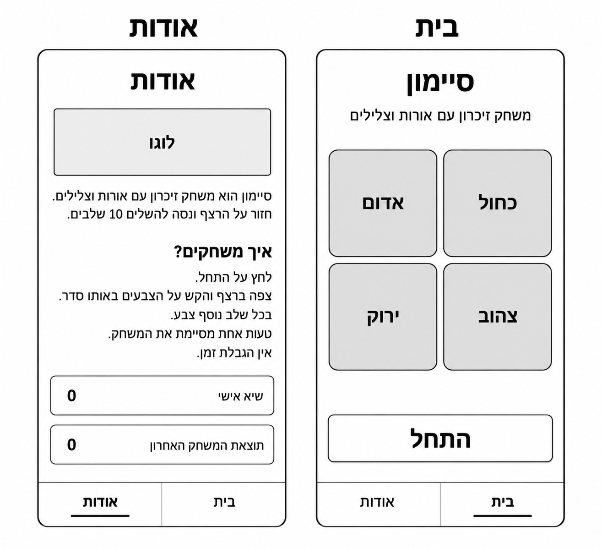
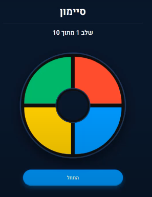
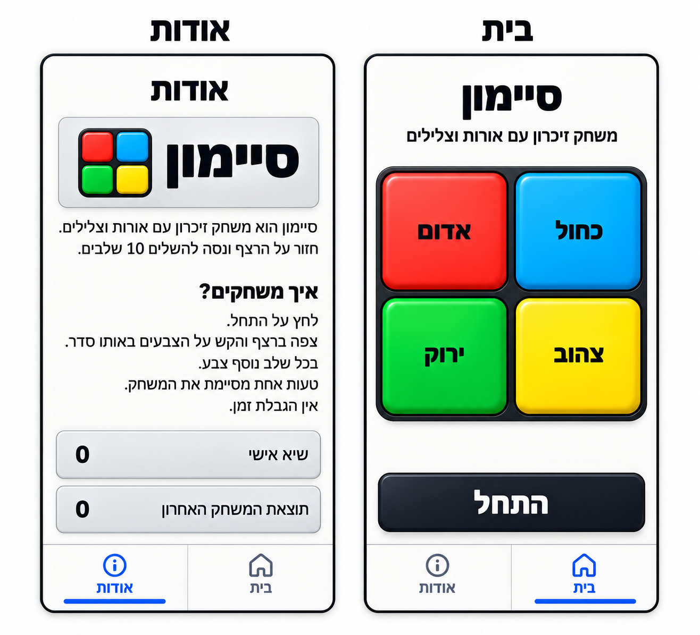
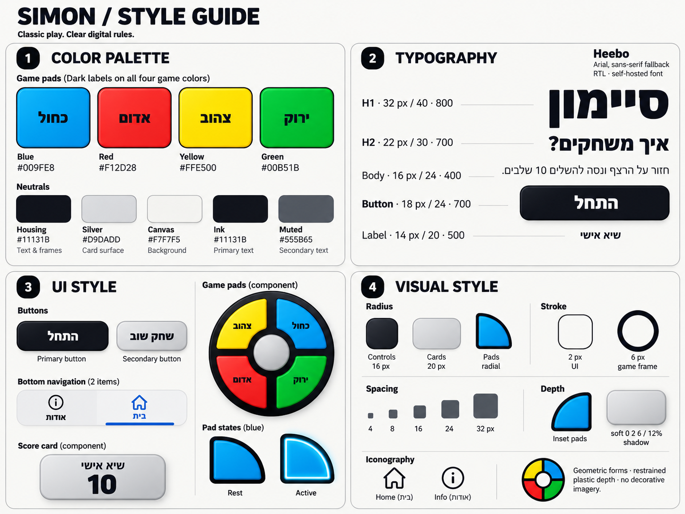

# DESIGN — סיימון

מסמך עיצוב למימוש ממשק מובייל בעברית. ה־PRD מגדיר את ההתנהגות; ה־Wireframes מגדירים את המבנה; ה־Style Guide מגדיר את השפה החזותית; וה־Mockups מגדירים את המראה הסופי. במקרה של הבדל חזותי, נשמרים המבנה והתוכן של ה־Wireframes לצד הסגנון של ה־Style Guide והמראה של ה־Mockups.

## 1. Screens — מסכי האפליקציה

### תמונת המבנה

### 1.1 בית

**מטרת המסך:** משחק סיימון, החל מהתחלה ועד להצגת התוצאה ומשחק חוזר.

> **עדכון (19 באוקטובר 2026, לבקשת המשתמש):** מסך הבית עבר למראה כהה עם לוח עגול, לפי תמונת הייחוס [home-dark-reference.png](home-dark-reference.png). בסעיף זה, התמונה הזו מחליפה את ה־Mockup ואת ה־Wireframe של מסך הבית. נשמרו מתוך המסמך המקורי: שמות הצבעים בעברית על הלוח ומיקום הצבעים. התאמת מסך האודות למראה הכהה מתוארת בעדכון שבסעיף 1.2.

**מבנה ותוכן, מלמעלה למטה:**

- כותרת עליונה מרכזית **„סיימון”**, לבנה ובמשקל כבד, עם קו הפרדה דק מתחתיה לכל רוחב המסך. אין כותרת משנה.
- שורת סטטוס מרכזית: **„שלב N מתוך 10”**, ובמהלך משחק גם **„צפה ברצף”** / **„תורך”**. בסיום מוצגות בה הודעת הסיום (גדולה ובולטת) והתוצאה.
- לוח משחק עגול במרכז: עיגול כהה עם טבעת מסגרת, ארבעה רבעים צבעוניים המופרדים בקווים כהים, ומרכז עגול כהה. המיקום קבוע: **כחול למעלה מימין, אדום למעלה משמאל, צהוב למטה מימין וירוק למטה משמאל**. כל רבע מציג את שם הצבע בטקסט כהה ובולט, מוזז לכיוון השוליים כדי שהמרכז לא יסתיר אותו.
- כפתור **„התחל”** רחב בצורת גלולה, בכחול עם הילה עדינה וטקסט לבן. בסיום מופיע במקומו **„שחק שוב”** בסגנון מתאר כחול.
- Bottom Navigation בתחתית המסך (נוסף ב־Milestone 3): **„בית”** מימין ו־**„אודות”** משמאל, עם אייקון מעל כל תווית; הפריט הפעיל מסומן בכחול ובקו תחתון.

הלוח הוא מוקד המסך. האזור שבמרכז הלוח אינו לחיץ.

**פעולות וניווט:** „התחל”, לחיצה על הצבעים, „שחק שוב” בסיום ומעבר ל„אודות”. כללי הפעולה נשארים כפי שהוגדרו ב־PRD.

**צבעי מסך הבית:**

| Token / שימוש | HEX |
|---|---|
| Blue | `#0A9FF5` |
| Red | `#FF4D2E` |
| Yellow | `#F7C600` |
| Green | `#16B868` |
| רקע (מעבר מלמעלה למטה) | `#0D1A2C` ← `#070F1C` |
| לוח ומרכז הלוח | `#0A1422`, טבעת `#1C2C42` |
| טקסט ראשי | `#FFFFFF` |
| טקסט משני | `#9AA7B8` |
| תוויות הצבעים | `#11131B` |

ערכים אלה הותאמו לתמונת הייחוס ומחליפים במסך הבית את טבלת הצבעים שבסעיף 2.1. הגופן, גודלי הטקסט, Focus ומידות המגע נשארים לפי סעיף 2.

### 1.2 אודות

**מטרת המסך:** הצגת הסבר המשחק, הוראות ושתי התוצאות השמורות.

> **עדכון (20 באוקטובר 2026, לבקשת המשתמש):** מסך האודות ופס הניווט התחתון (בשני המסכים) עוברים למראה הכהה של מסך הבית: אותו רקע מדורג (`#0D1A2C` ← `#070F1C`), טקסט ראשי לבן וטקסט משני `#9AA7B8`. אזור הלוגו וכרטיסי התוצאה הם משטחים כהים מורמים במקום משטחי Silver: רקע `#0A1422`, מסגרת `#1C2C42`, פינות 20 px וצל רך. הניווט כהה (רקע `#0A1422`, קו עליון `#1C2C42`); הפריט הפעיל כחול `#0A9FF5` עם קו תחתון, והלא־פעיל `#9AA7B8`. סמל הלוגו הוא **עיגול בארבעה רבעים צבעוניים**, תואם ללוח העגול של הבית (כחול למעלה מימין, אדום למעלה משמאל, צהוב למטה מימין, ירוק למטה משמאל), במקום ארבעת הריבועים שב־Mockup; לצדו השם „סיימון”. מבנה המסך, סדר התוכן והטקסטים נשארים כמתואר למטה ולפי ה־Mockup. בכל הנוגע לצבעים, למשטחים ולסמל הלוגו של מסך האודות והניווט, עדכון זה גובר על ה־Mockup ועל סעיפים 2.1 ו־2.3.

**מבנה ותוכן, מלמעלה למטה:**

- כותרת מרכזית **„אודות”**, באותה משפחת גופנים ובאותו סגנון כותרת של הבית.
- אזור לוגו אופקי על משטח Silver מעוגל עם קו מתאר וצל עדין. ב־Mockup מופיע שם המשחק „סיימון” לצד סימן של ארבעה ריבועים צבעוניים במסגרת כהה. זהו המראה הרצוי באזור שהיה Placeholder ב־Wireframe.
- פסקת תיאור מיושרת לימין: **„סיימון הוא משחק זיכרון עם אורות וצלילים. חזור על הרצף ונסה להשלים 10 שלבים.”**
- כותרת משנה מודגשת ומיושרת לימין: **„איך משחקים?”**
- הוראות בטקסט רגיל, בשורות נפרדות וללא רכיבי פעולה: **„לחץ על התחל.”**, **„צפה ברצף והקש על הצבעים באותו סדר.”**, **„בכל שלב נוסף צבע.”**, **„טעות אחת מסיימת את המשחק.”**, **„אין הגבלת זמן.”**
- שני כרטיסי תוצאה אופקיים ורחבים, זה מתחת לזה. הראשון: **„שיא אישי”**; השני: **„תוצאת המשחק האחרון”**. התווית בצד ימין והמספר הגדול בצד שמאל. הכרטיסים בגוון Silver, עם פינות מעוגלות, מסגרת דקה וצל עדין. ערכי 0 בתמונות הם דוגמה בלבד; בממשק מוצגים הערכים השמורים.
- אותו Bottom Navigation של הבית, כשהפעם **„אודות”** ואייקון המידע מסומנים בכחול ובקו תחתון, ו„בית” מעומעם.

כרטיסי התוצאה הם רכיבי תצוגה, ללא פעולה נוספת. בדוגמת ה־Style Guide מופיע כרטיס עם מספר מתחת לתווית; במסך הממשי יש לשמור על המבנה האופקי המופיע ב־Wireframes וב־Mockups.

**פעולות וניווט:** לחיצה על „בית” מחזירה למסך המשחק. התנהגות ההשהיה והחזרה נקבעת ב־PRD.

**הערת התאמה לנכס הלוגו:** המראה באזור הלוגו ב־Mockup שונה מהנכס המוקדם `logo.svg`. התמונה היא מקור המראה הסופי; אין להניח שהנכס המוקדם כבר תואם לה או לשנות את מבנה האזור כדי להתאים אליו.

### 1.3 ניווט ופריסה כללית

שני מסכים בלבד, עם Bottom Navigation עקבי בשתי עמודות שוות. המיקום של „בית” מימין ושל „אודות” משמאל אינו מתחלף בין המסכים. הבחירה הפעילה מובחנת גם באמצעות קו תחתון, ולא רק באמצעות צבע.

שני ה־Viewports המוצגים בלוח בעלי מידות ופרופורציות אחידות של Smartphone. בלוח התמונות הבית מופיע מימין והאודות משמאל. הכותרות שמעל המסגרות הן תוויות להצגת המסכים במסמך, ואינן כותרות UI נוספות שיש לשכפל בתוך האפליקציה. גם מסגרת ה־Viewport אינה רכיב מסך שיש לצייר במוצר.

במובייל שומרים על סדר התוכן והיחסים בין האזורים; אין לקבע את מידות התמונה כמידות CSS. כאשר התוכן אינו נכנס בגובה הזמין, מאפשרים גלילה של התוכן בלי להסתירו מאחורי הניווט ובלי להאריך באופן מלאכותי את מסגרת המכשיר.

### המראה החזותי הסופי

## 2. Style Guide — השפה העיצובית

### 2.1 Color Palette

| Token / שימוש | HEX | אופן שימוש |
|---|---|---|
| Blue | `#009FE8` | כפתור כחול בלוח וסימן הלוגו |
| Red | `#F12D28` | כפתור אדום בלוח וסימן הלוגו |
| Yellow | `#FFE500` | כפתור צהוב בלוח וסימן הלוגו |
| Green | `#00B51B` | כפתור ירוק בלוח וסימן הלוגו |
| Housing | `#11131B` | מסגרת לוח, הפרדות וכפתור ראשי |
| Ink | `#11131B` | כותרות, טקסט ראשי ותוויות הצבעים |
| Silver | `#D9DADD` | משטחי כרטיסים ואזור הלוגו |
| Canvas | `#F7F7F5` | רקע כללי בהיר |
| Muted | `#555B65` | טקסט משני ורכיבי ניווט לא פעילים |

הצבעים הרוויים ממוקדים בלוח ובלוגו; יתר המסך בהיר וניטרלי. הטקסט על כל ארבעת צבעי הלוח כהה. בכפתור הראשי הטקסט לבן, כפי שמופיע במקורות.

הניווט הפעיל מוצג בכחול בולט ב־Mockups, אך לא הוגדר לו HEX נפרד. אין להציג את הגוון המדויק שלו כ־Token מאושר נוסף. גם Stops של Gradients וגוני ההיילייט לא הוגדרו מספרית; ה־Mockups משמשים להם Reference חזותי.

### 2.2 Typography

משפחת הגופנים: **Heebo**, עם **Arial, sans-serif** כ־Fallback, כפי שמוגדר ב־Style Guide. הגופן מיועד לטעינה מקומית (`self-hosted`).

| שימוש | גודל מומלץ | Line Height | Font Weight |
|---|---:|---:|---:|
| H1 — „סיימון”, „אודות” | 32 px | 40 px | 800 |
| H2 — „איך משחקים?” | 22 px | 30 px | 700 |
| Body — תיאור והוראות | 16 px | 24 px | 400 |
| Button — „התחל”, „שחק שוב” | 18 px | 24 px | 700 |
| Label — תוויות וכרטיסים | 14 px | 20 px | 500 |

המספרים הם Design Tokens מתוך ה־Style Guide, לא מדידה של פיקסלים בתמונות המוגדלות. כותרות המסך מרכזיות וכבדות; פסקאות והוראות מיושרות לימין. מספרי התוצאות ותוויות הצבעים בולטים וגדולים יחסית לטקסט שסביבם, לפי ה־Mockups; לא הוגדר להם גודל מספרי נפרד. גם לכותרת המשנה בבית אין Token נפרד במקור.

### 2.3 UI Style

**כפתור ראשי:** משטח Near-black, טקסט לבן וכבד, פינות מעוגלות, קו מתאר כהה והיילייט עליון עדין. רוחב כמעט מלא באזור התוכן, כפי שמופיע בבית.

**כפתור משני:** „שחק שוב” בסגנון Silver עם טקסט כהה, מסגרת ועומק עדין, לפי דוגמת ה־Style Guide. עצם היעדרו מה־Mockup ההתחלתי אינו מבטל את הופעתו בסיום לפי ה־PRD.

**כפתורי המשחק:** ארבעה ריבועים מעוגלים, כל אחד בצבעו, עם קו מתאר כהה, הדגשת שפה פנימית ותחושת פלסטיק יצוק. שמות הצבעים נשארים ברורים במרכז. ב־Active משתמשים בהבהרה ובהדגשה פנימית בהירה בהשראת דוגמת ה־Style Guide, תוך שמירת הגוון והתווית. הדוגמה שם היא רדיאלית, אך במוצר ההדגשה עוקבת אחר קווי הכפתור הריבועי המעוגל.

**כרטיסים ואזור לוגו:** משטח Silver בהיר, מסגרת אפורה דקה, פינות מעוגלות וצל רך. גובה הכרטיס נגזר מתוכנו. בכרטיסי הניקוד נשמרת הפרדה ברורה בין התווית למספר, ללא הוספת אייקון או כפתור.

**Bottom Navigation:** שני פריטים שווים על משטח בהיר עם קו הפרדה עליון ומפריד אנכי, כפי שמופיע ב־Mockups. אייקון בית ואייקון מידע בקווי מתאר; התוויות מתחתיהם. הפריט הפעיל כחול ובעל קו תחתון רחב ומעוגל.

**אייקונים:** סגנון Outline פשוט ועקבי, עם Stroke של 2 px לפי ה־Style Guide. אין תמונות מפורטות או אייקונים מלאים לצד אייקוני הקו.

**מידות אינטראקציה:** Touch Target של לפחות 48 px ו־Focus גלוי עם Outline של 3 px, בהתאם ל־Style Guide. אין שדות קלט, טפסים או תפריטי אפשרויות במקורות, ולכן לא מוגדר להם סגנון.

### 2.4 Visual Style

האווירה היא משחק סיימון קלאסי בתרגום לממשק דיגיטלי: צבעים חזקים בתוך מסגרת כהה, משטחי Silver בהירים וטיפוגרפיה עברית מודגשת. העומק מאופק ומרוכז ברכיבים; הרקע נשאר נקי.

| מאפיין | הגדרה מתוך המקורות |
|---|---|
| Radius | Controls: ‏16 px; Cards: ‏20 px. בלוח נשמרת צורת הריבועים המעוגלים של ה־Mockup |
| Stroke | UI: ‏2 px; מסגרת משחק: ‏6 px, לפי דוגמאות ה־Style Guide |
| Spacing Scale | ‏4, 8, 16, 24, 32 px |
| Shadow | צל רך לדוגמה: `0 2px 6px rgba(0, 0, 0, 0.12)` |
| Depth | הדגשה פנימית בכפתורי המשחק, שפה בהירה וצל עדין ברכיבים מורמים |
| Layout | עמודה ראשית אחת; לוח משחק ב־Grid של 2×2; שני כרטיסי ניקוד זה מתחת לזה |

סולם ה־Spacing קובע שפה משותפת, אך המקורות אינם מגדירים Padding או Gap מדויקים לכל אזור. אין להסיק מהם מידות מחייבות שלא צוינו. במימוש יש לשמור על ההיררכיה והמרווחים היחסיים של ה־Mockups: כותרת וכותרת משנה, לוח מרכזי, הפרדה ברורה מהפעולה הראשית וניווט בתחתית.

אין צילומים או איורים דקורטיביים במסכים. התוכן הגרפי הוא הלוגו, ארבעת כפתורי המשחק ואייקוני הניווט. הלוגו באזור האודות משלב שם עברי וסימן ארבעת הצבעים לפי ה־Mockup.

### 2.5 שפה וכיווניות

כל ממשק המשתמש בעברית וב־RTL. הכותרות הראשיות ממורכזות; פסקאות, הוראות וכותרות תוכן מיושרות לימין. כפתורי הפעולה ותוויות הצבעים ממורכזים בתוך הרכיב שלהם. כרטיסי הניקוד מציגים תווית מימין ומספר משמאל, גם כשהמסמך RTL.

מיקום הצבעים מוגדר במפורש ואינו מתהפך אוטומטית עקב RTL. שמות הקטגוריות באנגלית בלוח ה־Style Guide מיועדים לתיעוד בלבד ואינם טקסטים לממשק האפליקציה.
